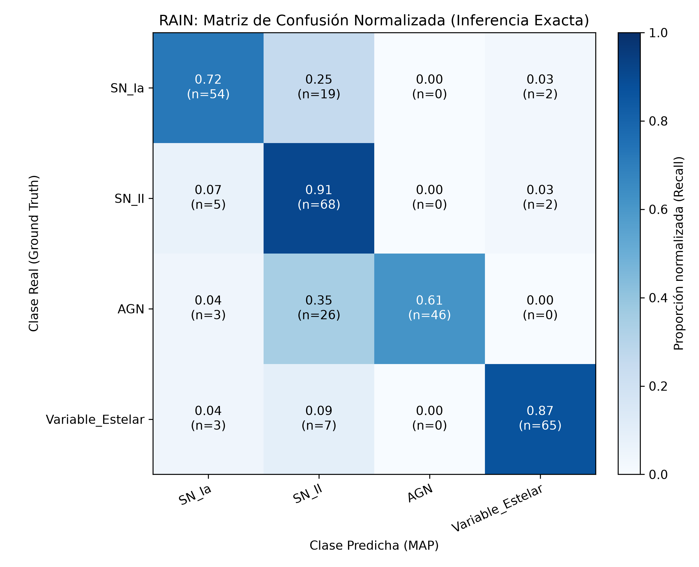
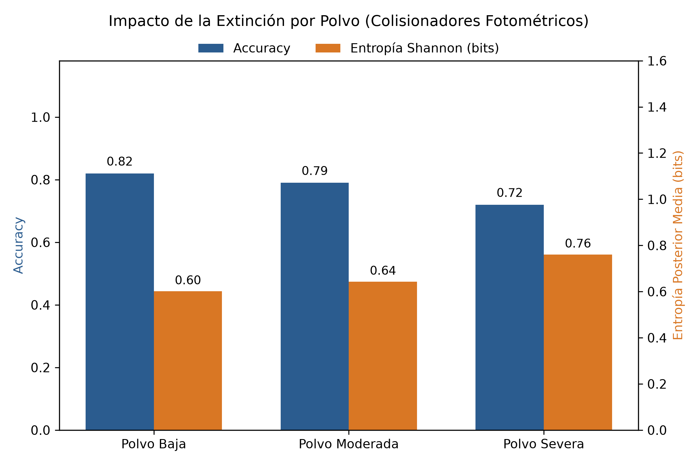

# RAIN: Diagnóstico Automatizado de Eventos Transitorios en Astrofísica

Sistema experto probabilístico basado en una **Red Bayesiana Causal de 12 nodos** para clasificar eventos transitorios astronómicos a partir de alertas telescópicas bajo incertidumbre, evidencia parcial y extinción por polvo interestelar.

Desarrollado para la asignatura **Razonamiento con Incertidumbre (RAIN)** del Grado en Inteligencia Artificial (Universidade de Vigo) por **Anxo Grandal Lama** y **Hugo Martínez Estévez**.

---

## Características Principales

* **Clasificación Probabilística Exacta (`pgmpy` + `VariableElimination`):** Diagnóstico sobre cuatro clases astrofísicas (`SN_Ia`, `SN_II`, `AGN` y `Variable_Estelar`) a partir de evidencia parcial o completa.
* **Modelado Causal del *Explaining Away*:** Incorpora dos colisionadores fotométricos (*estructuras en V*) acoplados a la variable latente `Extincion_Polvo`, permitiendo distinguir si un transitorio rojo y débil es intrínsecamente frío/tenue o una supernova luminosa oscurecida por polvo galáctico.
* **Inferencia Explicativa de Física Latente:** Estima las distribuciones posteriores de variables no observadas directamente (`Extincion_Polvo`, `Temperatura_Intrinseca`, `Luminosidad_Pico` y `Velocidad_Expansion`).
* **Planificación Activa de Observaciones:** Calcula la Entropía de Shannon $H(T \mid E)$ y la Ganancia de Información esperada $IG(T; X_i \mid E)$ para recomendar qué instrumento o seguimiento telescópico reduce más la incertidumbre.
* **Discretización Dinámica e Ingesta Masiva:** Transformación física parametrizable mediante `config.json` o percentiles empíricos del catálogo, con conversión astrofísica flujo-luminosidad $L_X = 4\pi d_L(z)^2 F_X$ y validación estricta de esquemas CSV (`RealDataLoader`).
* **Interfaz Dual (CLI + Dashboard Web):** Ejecutable tanto por terminal interactiva (`main.py`) como a través de una interfaz visual web (`src/view/dashboard.py`).

---

## Topología Causal del Modelo (DAG de 12 Nodos y 18 Aristas)

El modelo organiza las variables en **4 estratos causales**:

1. **Contexto Galáctico:** `Galaxia_Anfitriona`, `Ubicacion_Galactica`.
2. **Transitorio Objetivo:** `Tipo_Transitorio` $\in \{\text{SN\_Ia}, \text{SN\_II}, \text{AGN}, \text{Variable\_Estelar}\}$.
3. **Física Interna Latente y Medio Local:** `Extincion_Polvo`, `Temperatura_Intrinseca`, `Luminosidad_Pico`, `Velocidad_Expansion`.
4. **Observables Instrumentales:** `Color_Observado`, `Magnitud_Aparente`, `Emision_RayosX`, `Anchura_Lineas`, `Forma_Curva_Luz`.

Colisionadores fotométricos clave especificados en las CPTs del Anexo A:

$$\text{Temperatura\_Intrinseca} \longrightarrow \text{Color\_Observado} \longleftarrow \text{Extincion\_Polvo}$$
$$\text{Luminosidad\_Pico} \longrightarrow \text{Magnitud\_Aparente} \longleftarrow \text{Extincion\_Polvo}$$

---

## Arquitectura del Proyecto (Patrón MVC)

```text
transitorios/
├── .streamlit/
│   └── config.toml                      # Tema oscuro astronómico y telemetría desactivada
├── config.json                          # Umbrales físicos configurables y modo percentiles
├── data/
│   ├── casos_prueba.json                # Casos de prueba oficiales CP-01 a CP-04
│   └── validation_set.csv               # Catálogo de validación por lotes (120 objetos)
├── docs/
│   ├── Entrega_Arquitectura_transitorios_astrofisicos.pdf
│   ├── diseno_arquitectura_variables.md
│   └── figures/
│       ├── confusion_matrix_normalized.png
│       └── explaining_away_dust_analysis.png
├── reports/
│   └── evaluation_metrics.json          # Métricas de clasificación, Brier Score y auditoría EA
├── scripts/
│   └── evaluate_batch.py                # Pipeline de benchmarking masivo y generación de figuras
├── src/
│   ├── model/
│   │   ├── dtos.py                      # AstronomicalAlert, DiagnosisResult y DiscretizationConfig
│   │   └── transient_model.py           # DAG causal, 12 CPTs exactas, VariableElimination e IG
│   ├── controller/
│   │   ├── diagnosis_controller.py      # Orquestador MVC de flujos CLI y lotes JSON
│   │   └── real_data_loader.py          # Ingesta robusta de CSVs con validación y logging
│   └── view/
│       ├── console_view.py              # Vista interactiva por terminal (CLI)
│       └── dashboard.py                 # Vista visual interactiva en Streamlit
├── tests/
│   ├── test_rain.py                     # Concordancia arquitectónica, DAG y casos CP-01 a CP-04
│   └── test_real_data.py                # Ingesta CSV, discretización dinámica y estabilidad pgmpy
├── main.py                              # Punto de entrada de la interfaz CLI
├── verificar_modelo.py                  # Verificación rápida de CP-01 a CP-04
└── requirements.txt                     # Dependencias Python del proyecto
```

---

## Instalación

Requiere **Python 3.11+**. Se recomienda utilizar un entorno virtual aislado:

```bash
git clone git@github.com:hugo-martinez-hme/transitorios.git
cd transitorios
python3 -m venv .venv
source .venv/bin/activate
pip install -r requirements.txt
```

---

## Guía de Ejecución

Con el entorno virtual activado (`source .venv/bin/activate`):

### 1. Interfaz Visual Interactiva (Dashboard Web)
```bash
PYTHONPATH=. python3 -m streamlit run src/view/dashboard.py
```

### 2. Interfaz Interactiva de Consola (CLI)
```bash
python3 main.py
```

### 3. Pipeline de Evaluación Masiva y Auditoría de *Explaining Away*
Ejecuta inferencia exacta sobre `data/validation_set.csv`, exporta `reports/evaluation_metrics.json` y actualiza los gráficos en `docs/figures/`:
```bash
PYTHONPATH=. python3 scripts/evaluate_batch.py
```

### 4. Verificación de Casos Oficiales (CP-01 a CP-04)
```bash
python3 verificar_modelo.py
```

### 5. Suite Completa de Tests Unitarios e Integración (9 tests)
```bash
PYTHONPATH=. python3 -m unittest discover -s tests -v
```

---

## Resultados de Validación y Auditoría Probabilística

Sobre el conjunto de validación realista de 300 transitorios con ruido instrumental y evidencia parcial (`data/validation_set.csv`, 75 objetos por clase distribuidos equitativamente en polvo `Baja`, `Moderada` y `Severa`):

| Métrica | Valor |
| :--- | :---: |
| **Accuracy Global** | `0.7767` |
| **F1-Score Macro** | `0.7830` |
| **Brier Score Multiclase** *(referencia uniforme: `0.7500`)* | `0.3552` |
| **Accuracy por severidad de polvo (Baja $\to$ Moderada $\to$ Severa)** | `0.82` $\to$ `0.79` $\to$ `0.72` |
| **Entropía Posterior Media (Baja $\to$ Moderada $\to$ Severa)** | `0.60` $\to$ `0.64` $\to$ `0.76` bits |
| **$P(\text{Polvo}=\text{Severa} \mid E)$ inferida (Baja $\to$ Moderada $\to$ Severa)** | `0.1213` $\to$ `0.2329` $\to$ `0.6643` |
| **Contrafactual $\Delta P(\text{Temperatura}=\text{Alta})$ (Severa vs. Baja)** | `+0.4572` |
| **Contrafactual $\Delta P(\text{Luminosidad}=\text{Muy\_Alta})$ (Severa vs. Baja)** | `+0.4029` |
| **Contrafactual $\Delta P(\text{Tipo}=\text{SN\_Ia})$ (Severa vs. Baja)** | `+0.0787` |

### Visualizaciones Generadas

<p align="center">
  
  
</p>

---

## Autores

* **Anxo Grandal Lama**
* **Hugo Martínez Estévez**

*Grado en Inteligencia Artificial · Universidade de Vigo (UVigo)*