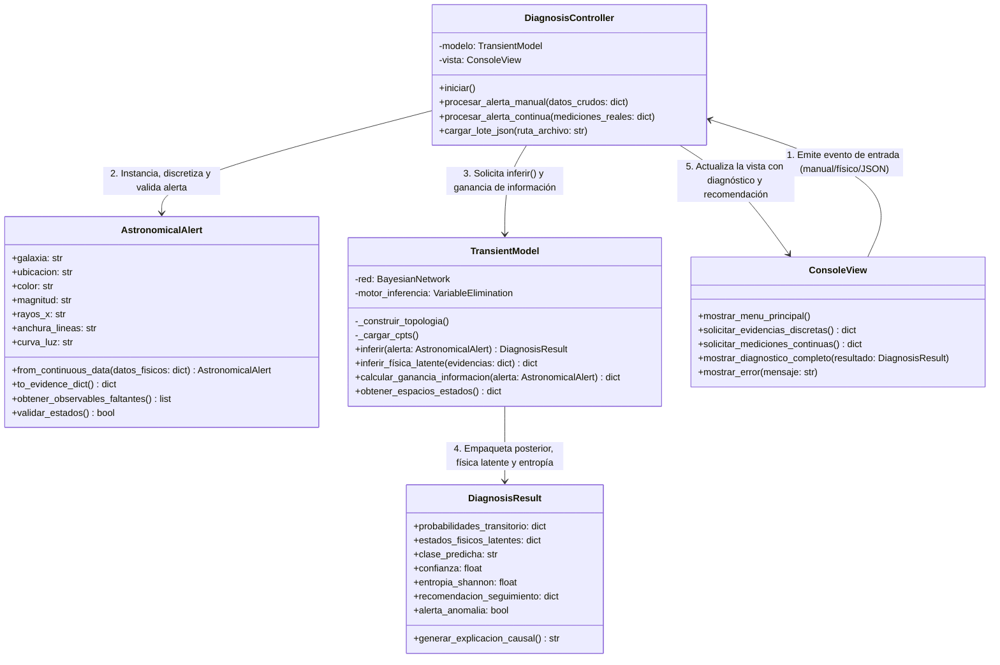
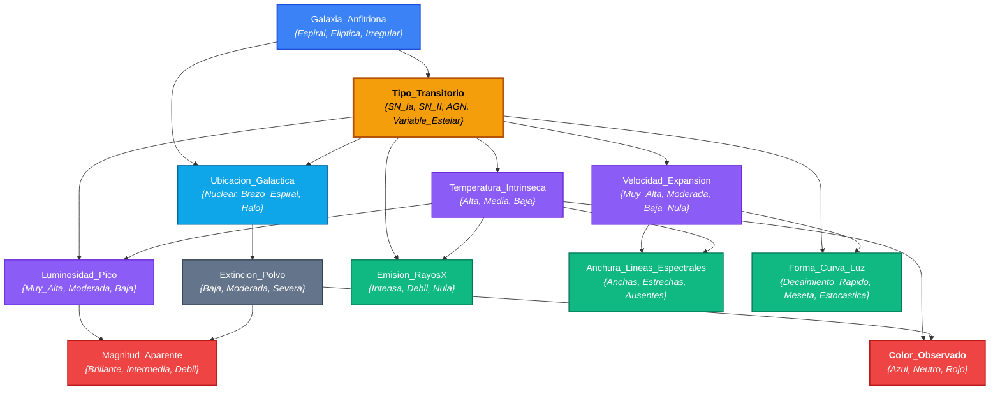

# Especificación Técnica: Arquitectura del Sistema y Diseño de la Red Bayesiana

**Materia:** Razonamiento con Incertidumbre (RAIN) - Grado en Inteligencia Artificial  
**Autores:** Anxo Grandal Lama y Hugo Martínez Estévez  
**Entrega Oficial:** Arquitectura y Diseño del Sistema (Sesión 7)

---

## 1. Arquitectura del Software: Patrón MVC con Razonamiento Explicativo y Activo

El sistema se organiza bajo el patrón **Modelo-Vista-Controlador (MVC)** para ejecución local, garantizando el desacoplamiento entre la interfaz de usuario, la validación/discretización de alertas astronómicas y el motor probabilístico en `pgmpy`:



### 1.1. Módulos, Responsabilidades y Comunicación
1. **Vista (`ConsoleView`):** Gestiona la interacción con el usuario por terminal. Permite introducir datos en modo cualitativo (estados discretos), modo cuantitativo (valores astrofísicos continuos como magnitudes o velocidades en $\text{km/s}$) o mediante carga de ficheros de alertas. Presenta tanto la clasificación como la explicación física y la recomendación de seguimiento.
2. **Controlador (`DiagnosisController`) y Entidad de Entrada (`AstronomicalAlert`):** El controlador coordina las peticiones. `AstronomicalAlert` actúa como adaptador y validador: discretiza mediciones instrumentales reales hacia los estados de la red, filtra valores nulos e identifica qué variables observables han quedado sin medir.
3. **Modelo (`TransientModel`) y Entidad de Salida (`DiagnosisResult`):** `TransientModel` construye el grafo en `pgmpy` y ejecuta inferencia exacta (`VariableElimination`) en tres niveles:
   * **Inferencia diagnóstica:** Calcula $P(\text{Tipo\_Transitorio} \mid \mathbf{e})$.
   * **Inferencia explicativa (Física Latente):** Estima el estado posterior de las variables ocultas (`Extincion_Polvo`, `Temperatura_Intrinseca`, `Luminosidad_Pico`, `Velocidad_Expansion`) para explicar el resultado.
   * **Planificación activa de observaciones:** Si existen observables no medidos, calcula la reducción esperada de entropía de Shannon para recomendar qué instrumento telescópico emplear a continuación.

---

## 2. Especificación Formal de Variables, Estados y Umbrales de Discretización

El modelo probabilístico consta de **12 variables discretas** distribuidas en cuatro niveles causales, con umbrales físicos definidos para permitir la conversión automática desde datos telescópicos reales:

| Variable | Nivel y Rol en la Red | Espacio de Estados Discretos | Criterio Físico / Umbrales de Discretización |
| :--- | :--- | :--- | :--- |
| **`Galaxia_Anfitriona`** | Nivel 1: Contexto (Prior) | `{Espiral, Eliptica, Irregular}` | Morfología Hubble/de Vaucouleurs en catálogos previos (SDSS/Pan-STARRS). |
| **`Tipo_Transitorio`** | **Nivel 2: Objetivo Diagnóstico** | `{SN_Ia, SN_II, AGN, Variable_Estelar}` | Naturaleza astrofísica real del evento transitorio que se desea clasificar. |
| **`Ubicacion_Galactica`** | Nivel 3: Contexto Espacial | `{Nuclear, Brazo_Espiral, Halo}` | Distancia proyectada al centro galáctico ($r < 1\text{ kpc}$: Nuclear; disco: Brazo; $>15\text{ kpc}$: Halo). |
| **`Extincion_Polvo`** | Nivel 3: Medio Interestelar (Latente) | `{Baja, Moderada, Severa}` | Absorción en banda visual $A_V$: Baja ($<0.3\text{ mag}$), Moderada ($0.3\text{ - }1.5\text{ mag}$), Severa ($>1.5\text{ mag}$). |
| **`Temperatura_Intrinseca`** | Nivel 3: Física Térmica (Latente) | `{Alta, Media, Baja}` | Temperatura de cuerpo negro $T_{\text{eff}}$: Alta ($>15.000\text{ K}$), Media ($7.000\text{ - }15.000\text{ K}$), Baja ($<7.000\text{ K}$). |
| **`Luminosidad_Pico`** | Nivel 3: Física Energética (Latente) | `{Muy_Alta, Moderada, Baja}` | Magnitud absoluta $M_V$: Muy Alta ($<-18.5$), Moderada ($-15\text{ a }-18.5$), Baja ($>-15$). |
| **`Velocidad_Expansion`** | Nivel 3: Cinemática (Latente) | `{Muy_Alta, Moderada, Baja_Nula}` | Velocidad de eyección $v$: Muy Alta ($>10.000\text{ km/s}$), Moderada ($2.000\text{ - }10.000\text{ km/s}$), Baja ($<2.000\text{ km/s}$). |
| **`Color_Observado`** | Nivel 4: Observable Fotométrico | `{Azul, Neutro, Rojo}` | Índice de color aparente $(g - r)$: Azul ($<0.0\text{ mag}$), Neutro ($0.0\text{ a }0.5\text{ mag}$), Rojo ($>0.5\text{ mag}$). |
| **`Magnitud_Aparente`** | Nivel 4: Observable Fotométrico | `{Brillante, Intermedia, Debil}` | Flujo aparente corregido por distancia: Brillante ($m < 17$), Intermedia ($17\text{ - }19.5$), Débil ($>19.5$). |
| **`Emision_RayosX`** | Nivel 4: Observable Alta Energía | `{Intensa, Debil, Nula}` | Luminosidad en banda $0.5\text{ - }10\text{ keV}$: Intensa ($L_X > 10^{42}\text{ erg/s}$), Débil ($10^{39}\text{ - }10^{42}$), Nula. |
| **`Anchura_Lineas_Espectrales`** | Nivel 4: Observable Espectroscópico | `{Anchas, Estrechas, Ausentes}` | Ensanchamiento Doppler FWHM: Anchas ($>3.000\text{ km/s}$), Estrechas ($<3.000\text{ km/s}$), Continuo sin líneas. |
| **`Forma_Curva_Luz`** | Nivel 4: Observable Temporal | `{Decaimiento_Rapido, Meseta, Estocastica}` | Evolución fotométrica multiepoch: caída lineal ($>0.08\text{ mag/día}$), meseta constante ($\sim 80\text{ días}$) o fluctuación aperiódica. |

---

## 3. Topología Causal y Arquitectura de la Red Bayesiana (DAG)

El Grafo Acíclico Dirigido (DAG) organiza el conocimiento causal en cuatro estratos jerárquicos, conectando la demografía galáctica y el fenómeno subyacente con las propiedades físicas latentes y las señales medidas en el telescopio:



### 3.1. Justificación de las Cadenas Causales y Profundidad de la Red

1. **Rama Espacial y de Atenuación del Medio (`Galaxia` $\rightarrow$ `Ubicacion` $\rightarrow$ `Polvo`):**
   * La morfología de la `Galaxia_Anfitriona` y la naturaleza del `Tipo_Transitorio` determinan la `Ubicacion_Galactica`.
   * Esta coordenada espacial condiciona la `Extincion_Polvo`: los eventos en el núcleo galáctico o en los brazos espirales atraviesan columnas densas de gas y polvo, mientras que en el halo periférico la línea de visión está despejada.
2. **Rama Fotométrica y Doble Estructura Colisionadora (`Color_Observado` y `Magnitud_Aparente`):**
   * El polvo interestelar converge sobre dos observables fotométricos formando dos estructuras en V (*colliders*) acopladas:
     * **Enrojecimiento (`Temperatura_Intrinseca` $\rightarrow$ `Color_Observado` $\leftarrow$ `Extincion_Polvo`):** Un evento intrínsecamente azul (alta temperatura) se observará como rojo si sufre extinción severa.
     * **Atenuación de Brillo (`Luminosidad_Pico` $\rightarrow$ `Magnitud_Aparente` $\leftarrow$ `Extincion_Polvo`):** Una explosión muy luminosa (`Luminosidad_Pico = Muy_Alta`) se registrará con una `Magnitud_Aparente = Debil` si la nube de polvo absorbe los fotones en la línea de visión.
3. **Rama de Alta Energía (`Tipo_Transitorio` y `Temperatura` $\rightarrow$ `Emision_RayosX`):**
   * La detección de rayos X responde bien a la emisión no térmica de la corona de un `AGN`, o bien a ondas de choque circunestelares a temperaturas extremas.
4. **Rama Espectroscópica y Temporal (`Velocidad_Expansion` $\rightarrow$ `Anchura_Lineas` y `Curva_Luz`):**
   * La `Velocidad_Expansion` ensancha por efecto Doppler la `Anchura_Lineas_Espectrales` y regula la velocidad de difusión fotónica que define la `Forma_Curva_Luz`.

---

## 4. Factorización de la Distribución Conjunta

Aplicando la propiedad de Markov local sobre los 12 nodos del DAG, la distribución de probabilidad conjunta global se factoriza como:

$$P(G, T, U, E, \theta, L_p, V, M, C, X, A, F) = P(G) \cdot P(T \mid G) \cdot P(U \mid G, T) \cdot P(E \mid U) \cdot P(\theta \mid T) \cdot P(L_p \mid T, \theta) \cdot P(V \mid T) \cdot P(M \mid L_p, E) \cdot P(C \mid \theta, E) \cdot P(X \mid T, \theta) \cdot P(A \mid V, \theta) \cdot P(F \mid T, V)$$

---

## 5. Conocimiento Probabilístico: Fuentes, Supuestos y Parametrización (CPTs)

La parametrización cuantitativa (`TabularCPD` en `pgmpy`) se fundamenta en distribuciones observacionales de sondeos astronómicos (*Zwicky Transient Facility - ZTF* y tasas morfológicas de Li et al.) bajo tres principios:

* **Restricciones Astrofísicas Fuertes ($\approx 0.005 - 0.98$):** En galaxias elípticas (`Eliptica`), la ausencia de formación estelar joven reduce la probabilidad de supernovas de colapso de núcleo (`SN_II`) a valores residuales ($P(T=\text{SN\_II} \mid G=\text{Eliptica}) = 0.01$). Análogamente, los núcleos activos (`AGN`) quedan restringidos a la región central ($P(U=\text{Nuclear} \mid T=\text{AGN}) = 0.98$).
* **Acoplamiento de Extinción en el Doble Colisionador:** La presencia de `Extincion_Polvo = Severa` desplaza simultáneamente las distribuciones de `Color_Observado` hacia `Rojo` y de `Magnitud_Aparente` hacia `Debil`, permitiendo que el motor resuelva el *explaining away* cuando ambos síntomas concurren en regiones ricas en polvo.
* **Control de Complejidad:** Limitar el número máximo de padres a 2 mantiene las CPTs en un máximo de 36 celdas ($3 \times 12$), evitando la explosión combinatoria.

| Nodo (Variable) | Padres Condicionantes | Dimensión CPT | Criterio Astrofísico de Parametrización |
| :--- | :--- | :--- | :--- |
| **`Galaxia_Anfitriona`** | Ninguno (Prior) | $3 \times 1$ | Fracción morfológica en el universo local ($\sim 60\%$ Espiral, $25\%$ Elíptica, $15\%$ Irregular). |
| **`Tipo_Transitorio`** | `Galaxia_Anfitriona` | $4 \times 3$ | Tasas relativas de transitorios por tipo morfológico (ausencia de SN II en elípticas). |
| **`Ubicacion_Galactica`** | `Galaxia`, `Tipo_Transitorio` | $3 \times 12$ | Confinamiento nuclear de AGN y concentración de SN II en brazos espirales. |
| **`Extincion_Polvo`** | `Ubicacion_Galactica` | $3 \times 3$ | Columna de polvo $A_V$ elevada en núcleo y brazos espirales; mínima en el halo. |
| **`Temperatura_Intrinseca`** | `Tipo_Transitorio` | $3 \times 4$ | Emisión térmica UV/azul en fases jóvenes de SN y discos de acreción de AGN. |
| **`Luminosidad_Pico`** | `Tipo_Transitorio`, `Temperatura` | $3 \times 12$ | Ley de Stefan-Boltzmann y escala energética de explosiones vs estrellas variables. |
| **`Velocidad_Expansion`** | `Tipo_Transitorio` | $3 \times 4$ | Eyección violenta en supernovas ($>10^4\text{ km/s}$) frente a pulsación estelar ($<500\text{ km/s}$). |
| **`Magnitud_Aparente`** | `Luminosidad_Pico`, `Extincion_Polvo` | $3 \times 9$ | Atenuación del flujo observado en función de la columna de polvo interpuesta. |
| **`Color_Observado`** | `Temperatura`, `Extincion_Polvo` | $3 \times 9$ | Enrojecimiento selectivo por dispersión del polvo sobre el espectro térmico. |
| **`Emision_RayosX`** | `Tipo_Transitorio`, `Temperatura` | $3 \times 12$ | Emisión coronal intensa en AGN y bremsstrahlung térmico en choques muy calientes. |
| **`Anchura_Lineas_Espectrales`** | `Velocidad_Expansion`, `Temperatura` | $3 \times 9$ | Ensanchamiento Doppler cinemático dominante en envolturas de supernovas. |
| **`Forma_Curva_Luz`** | `Tipo_Transitorio`, `Velocidad_Expansion` | $3 \times 12$ | Caída radiactiva de $^{56}\text{Ni}$ (SN Ia), meseta de recombinación H (SN II) y caos (AGN). |

---

## 6. Diseño de la Inferencia, Planificación Activa y Casos de Prueba

El motor `VariableElimination` ejecuta tres operaciones complementarias ante un vector de evidencias observadas $\mathbf{e}$:

1. **Inferencia Diagnóstica:** Calcula la distribución posterior del nodo objetivo marginalizando las variables ocultas $\mathbf{Y}$:
   $$P(T \mid \mathbf{e}) = \alpha \sum_{\mathbf{y} \in \mathbf{Y}} P(T, \mathbf{e}, \mathbf{y})$$
2. **Inferencia Explicativa de Estados Físicos Latentes:** Estima $P(\text{Extincion\_Polvo}, \text{Temperatura\_Intrinseca}, \text{Luminosidad\_Pico}, \text{Velocidad\_Expansion} \mid \mathbf{e})$ para justificar físicamente el diagnóstico ante efectos de enmascaramiento por polvo.
3. **Planificación de Seguimiento por Ganancia de Información (Entropía de Shannon):** Cuando existen variables observables aún no medidas $O_i \notin \mathbf{e}$ (por ejemplo, falta tomar un espectro o medir en rayos X), el sistema calcula la incertidumbre actual mediante la entropía de Shannon:
   $$H(T \mid \mathbf{e}) = -\sum_{t \in T} P(t \mid \mathbf{e}) \log_2 P(t \mid \mathbf{e})$$
   Y evalúa la **Ganancia de Información Esperada** para cada observación candidata $O_i$:
   $$IG(T; O_i \mid \mathbf{e}) = H(T \mid \mathbf{e}) - \sum_{o \in O_i} P(O_i = o \mid \mathbf{e}) \, H(T \mid \mathbf{e}, O_i = o)$$
   El sistema recomienda al astrónomo realizar la medición telescópica $\arg\max_{O_i} IG(T; O_i \mid \mathbf{e})$ que maximiza la reducción de incertidumbre.

### 6.1. Casos de Prueba y Comportamiento Esperado

| ID | Escenario Astrofísico | Evidencias Introducidas ($\mathbf{e}$) | Diagnóstico, Física Latente y Recomendación Esperada |
| :--- | :--- | :--- | :--- |
| **CP-01** | **Supernova Ia canónica en galaxia elíptica** | `Galaxia = Eliptica`, `Ubicacion = Halo`, `Magnitud = Brillante`, `Color = Azul`, `Curva = Decaimiento_Rapido` | **Diagnóstico:** `SN_Ia` ($>90\%$). Descarte físico de `SN_II` y `AGN`. **Latente:** `Extincion_Polvo = Baja`, `Luminosidad_Pico = Muy_Alta`. |
| **CP-02** | **Supernova oscurecida (*Explaining Away*)** | `Galaxia = Espiral`, `Ubicacion = Brazo_Espiral`, `Color = Rojo`, `Magnitud = Debil`, `Anchura_Lineas = Anchas` | **Diagnóstico:** Supernova (`SN_II` / `SN_Ia`) frente a `Variable_Estelar`. **Explicación Latente:** Infiere `Extincion_Polvo = Severa` y `Velocidad_Expansion = Muy_Alta`, explicando el color rojo y bajo brillo. |
| **CP-03** | **Núcleo Galáctico Activo (AGN)** | `Ubicacion = Nuclear`, `Emision_RayosX = Intensa`, `Curva = Estocastica` | **Diagnóstico:** `AGN` ($>95\%$). Baja entropía ($H < 0.25\text{ bits}$), no requiere observaciones adicionales. |
| **CP-04** | **Alerta fotométrica temprana (Planificación activa)** | Solo imagen inicial: `Galaxia = Espiral`, `Ubicacion = Brazo_Espiral`, `Color = Azul`, `Magnitud = Brillante` | **Diagnóstico preliminar:** Repartido entre `SN_II` y `SN_Ia` (Entropía moderada-alta). **Recomendación Activa:** Prioriza observar `Forma_Curva_Luz` y `Anchura_Lineas_Espectrales` (máxima ganancia $IG$) frente a `Emision_RayosX`. |

---

## 7. Interfaz Prevista (Prototipo de Pantallas CLI)

La interfaz (`ConsoleView`) ofrece selección de modo de entrada (cualitativo por menús, cuantitativo con discretización automática o por lote JSON) y un informe diagnóstico enriquecido con inferencia latente y recomendación telescópica:

### 7.1. Pantalla de Entrada de Datos (Modo Guiado / Discretización)
```text
==========================================================================
   SISTEMA BAYESIANO DE DIAGNÓSTICO Y SEGUIMIENTO DE TRANSITORIOS (RAIN)
==========================================================================
Modo de entrada: [1] Estados discretos  [2] Mediciones físicas  [3] Lote JSON
> Selección: 1

Seleccione las evidencias disponibles (Pulse [0] si aún no se ha observado):
  1. Galaxia Anfitriona        : [1] Espiral   [2] Elíptica   [3] Irregular   [0] N/D -> 1
  2. Ubicación Galáctica       : [1] Nuclear   [2] Brazo Esp. [3] Halo        [0] N/D -> 2
  3. Color Observado (g-r)     : [1] Azul      [2] Neutro     [3] Rojo        [0] N/D -> 3
  4. Magnitud Aparente         : [1] Brillante [2] Intermedia [3] Débil       [0] N/D -> 3
  5. Anchura Líneas Espectral. : [1] Anchas    [2] Estrechas  [3] Ausentes    [0] N/D -> 1
  6. Emisión de Rayos X        : [1] Intensa   [2] Débil      [3] Nula        [0] N/D -> 0
  7. Forma de Curva de Luz     : [1] Dec. Ráp. [2] Meseta     [3] Estocástica [0] N/D -> 0
```

### 7.2. Pantalla de Resultados: Diagnóstico, Explicación Física y Seguimiento
```text
--------------------------------------------------------------------------
   1. DISTRIBUCIÓN POSTERIOR DE DIAGNÓSTICO P(Tipo_Transitorio | e)
--------------------------------------------------------------------------
  * SN_II (Supernova Colapso)  : ███████████████████░░░░░░░░░░░  63.2 %
  * SN_Ia (Supernova Termon.)  : ██████████░░░░░░░░░░░░░░░░░░░░  34.1 %
  * AGN (Núcleo Activo)        : █░░░░░░░░░░░░░░░░░░░░░░░░░░░░░   2.1 %
  * Variable_Estelar           : ░░░░░░░░░░░░░░░░░░░░░░░░░░░░░░   0.6 %

  [ESTADO]: Diagnóstico en favor de Supernova (Entropía H = 1.08 bits)

--------------------------------------------------------------------------
   2. INFERENCIA DE PROPIEDADES FÍSICAS LATENTES (EXPLICABILIDAD CAUSAL)
--------------------------------------------------------------------------
  * Extinción por Polvo Est.   : SEVERA (82.4%)   <-- Activa Explaining Away
  * Temperatura Intrínseca Est.: ALTA / MEDIA (88.7%)
  * Velocidad de Expansión Est.: MUY ALTA (91.5%)
  > Explicación: Aunque el evento se observa ROJO y DÉBIL, las líneas anchas
    y su posición en el brazo espiral indican una explosión energética
    fuertemente oscurecida por polvo interestelar.

--------------------------------------------------------------------------
   3. RECOMENDADOR DE SEGUIMIENTO TELESCÓPICO (GANANCIA DE INFORMACIÓN)
--------------------------------------------------------------------------
  Observables pendientes para desempatar entre SN_II y SN_Ia:
  1º [RECOMENDADO] Forma_Curva_Luz  -> Ganancia esperada: 0.74 bits (-68% incertidumbre)
  2º [SECUNDARIO]  Emision_RayosX   -> Ganancia esperada: 0.05 bits (-4% incertidumbre)
==========================================================================
```