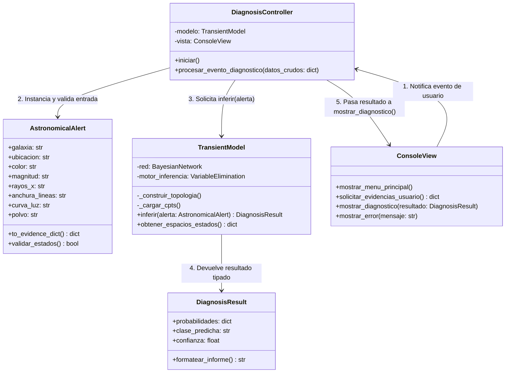
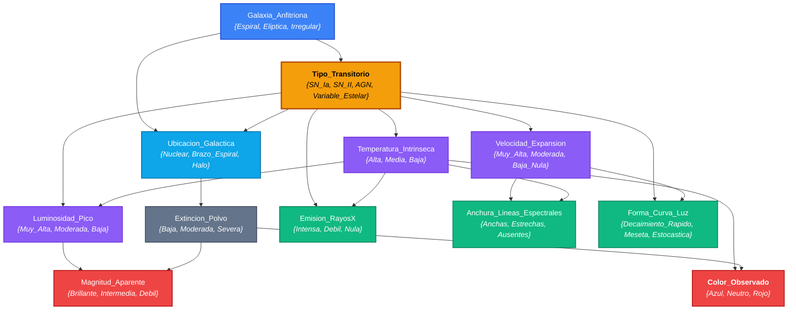

# Especificación Técnica: Arquitectura del Sistema y Diseño de la Red Bayesiana

**Materia:** Razonamiento con Incertidumbre (RAIN) - Grado en Inteligencia Artificial  
**Autores:** Anxo Grandal Lama y Hugo Martínez Estévez  
**Estado:** Documento formal de arquitectura y modelado causal (Hito Sesiones 5 a 7)

---

## 1. Arquitectura del Software: Patrón MVC

Para cumplir con la separación de responsabilidades y permitir la ejecución local desacoplada, la aplicación se estructura bajo el patrón **Modelo-Vista-Controlador (MVC)** apoyado en objetos de transferencia de datos:



### 1.1. Responsabilidades y Flujo de Interacción
1. **Entrada de datos (`ConsoleView`):** La vista captura las observaciones del usuario (alertas telescópicas reales o simuladas) y las envía al controlador sin interactuar con la lógica bayesiana.
2. **Validación y mediación (`DiagnosisController` y `AstronomicalAlert`):** El controlador recibe los datos crudos, valida que los estados observados pertenezcan a los dominios físicos permitidos instanciando un objeto tipado `AstronomicalAlert`, y solicita el diagnóstico al modelo.
3. **Núcleo probabilístico (`TransientModel`):** Encapsula tanto la inicialización de la red bayesiana en `pgmpy` (`_construir_topologia()` y `_cargar_cpts()`) como el cálculo probabilístico exacto mediante `VariableElimination`, empaquetando la distribución posterior en un objeto `DiagnosisResult`.
4. **Presentación de resultados:** El controlador recibe `DiagnosisResult` y le ordena a la vista mostrar el informe ordenado de probabilidades.

---

## 2. Especificación Formal de Variables y Espacios de Estados

El dominio modela **12 variables discretas**, exhaustivas y mutuamente excluyentes, organizadas desde el contexto galáctico y las propiedades físicas latentes hasta las mediciones instrumentales del telescopio:

| Variable | Rol en la Red | Espacio de Estados Discretos | Justificación Física / Dominio Astrofísico |
| :--- | :--- | :--- | :--- |
| **`Galaxia_Anfitriona`** | Contexto Causal (Prior) | `{Espiral, Eliptica, Irregular}` | Entorno estelar previo; las galaxias elípticas carecen de gas frío para formar estrellas masivas (impidiendo SN II). |
| **`Tipo_Transitorio`** | **Diagnóstico (Objetivo)** | `{SN_Ia, SN_II, AGN, Variable_Estelar}` | Fenómeno astrofísico real subyacente que el sistema debe inferir. |
| **`Ubicacion_Galactica`** | Estado Espacial / Observable | `{Nuclear, Brazo_Espiral, Halo}` | Coordenada en la galaxia; los AGN residen en el núcleo y las SN II en brazos espirales ricos en formación estelar. |
| **`Extincion_Polvo`** | Medio Interestelar | `{Baja, Moderada, Severa}` | Densidad de polvo cósmico en la línea de visión condicionada por la zona galáctica atravesada. |
| **`Temperatura_Intrinseca`** | Física Térmica Latente | `{Alta, Media, Baja}` | Temperatura efectiva de emisión en el foco antes de sufrir dispersión en el medio interestelar. |
| **`Luminosidad_Pico`** | Física Energética Latente | `{Muy_Alta, Moderada, Baja}` | Potencia lumínica intrínseca emitida por el evento (las supernovas Ia y los AGN brillan órdenes de magnitud más que las variables). |
| **`Velocidad_Expansion`** | Dinámica Cinemática Latente | `{Muy_Alta, Moderada, Baja_Nula}` | Velocidad física real de las capas de gas expulsadas o del disco de acreción. |
| **`Color_Observado`** | Observable Fotométrico | `{Azul, Neutro, Rojo}` | Índice de color aparente; colisionador entre la temperatura intrínseca y el enrojecimiento por polvo. |
| **`Magnitud_Aparente`** | Observable Fotométrico | `{Brillante, Intermedia, Debil}` | Brillo captado por el sensor; colisionador entre la luminosidad intrínseca y la absorción por polvo. |
| **`Emision_RayosX`** | Observable Alta Energía | `{Intensa, Debil, Nula}` | Flujo de fotones energéticos originado por acreción relativista (AGN) o choques térmicos extremos. |
| **`Anchura_Lineas_Espectrales`** | Observable Espectroscópico | `{Anchas, Estrechas, Ausentes}` | Ensanchamiento Doppler medido en el espectro óptico producto de la velocidad de expansión y agitación térmica. |
| **`Forma_Curva_Luz`** | Observable Temporal | `{Decaimiento_Rapido, Meseta, Estocastica}` | Evolución del brillo en el tiempo regulada por el mecanismo del transitorio y la velocidad de vaciado de la envoltura. |

---

## 3. Topología Causal y Arquitectura de la Red Bayesiana (DAG)

El Grafo Acíclico Dirigido (DAG) modela el flujo causal completo en cuatro estratos de profundidad: (1) entorno galáctico, (2) evento transitorio subyacente, (3) propiedades físicas intrínsecas y del medio local, y (4) señales astronómicas observables en los instrumentos:



### 3.1. Justificación de las Cadenas Causales y Profundidad de la Red

1. **Rama Espacial y de Atenuación del Medio (`Galaxia` $\rightarrow$ `Ubicacion` $\rightarrow$ `Polvo`):**
   * La morfología de la `Galaxia_Anfitriona` y la naturaleza del `Tipo_Transitorio` determinan la `Ubicacion_Galactica` donde se produce el fenómeno.
   * Esta coordenada espacial condiciona directamente la `Extincion_Polvo`: los eventos situados en el núcleo galáctico o inmersos en los brazos espirales atraviesan nubes densas de polvo interestelar, mientras que los eventos en el halo periférico presentan una línea de visión limpia.
2. **Rama Fotométrica y Doble Estructura Colisionadora (`Color_Observado` y `Magnitud_Aparente`):**
   * El polvo interestelar actúa sobre dos observables fotométricos simultáneos generando dos estructuras en V (*colliders*):
     * **Enrojecimiento (`Temperatura_Intrinseca` $\rightarrow$ `Color_Observado` $\leftarrow$ `Extincion_Polvo`):** Un objeto intrínsecamente azul (alta temperatura) será observado como rojo si existe extinción severa.
     * **Atenuación de Brillo (`Luminosidad_Pico` $\rightarrow$ `Magnitud_Aparente` $\leftarrow$ `Extincion_Polvo`):** Un evento de altísima energía (`Luminosidad_Pico = Muy_Alta`, determinado por el tipo de explosión y su temperatura) puede registrarse con una `Magnitud_Aparente = Debil` si la columna de polvo bloquea los fotones en ruta.
3. **Rama de Alta Energía (`Tipo_Transitorio` y `Temperatura` $\rightarrow$ `Emision_RayosX`):**
   * La detección de rayos X requiere o bien mecanismos no térmicos relativistas propios de la corona de un `AGN`, o bien ondas de choque con temperaturas extremas (`Temperatura_Intrinseca = Alta`).
4. **Rama Espectroscópica y Temporal (`Velocidad_Expansion` $\rightarrow$ `Anchura_Lineas` y `Curva_Luz`):**
   * La `Velocidad_Expansion` no es leída directamente por el telescopio, sino que se infiere a través de su efecto físico sobre el espectro: provoca el ensanchamiento por efecto Doppler en la `Anchura_Lineas_Espectrales` (junto con el ensanchamiento térmico de la temperatura) y regula el tiempo de difusión de los fotones que da forma a la `Forma_Curva_Luz`.

---

## 4. Factorización de la Distribución Conjunta

Aplicando la propiedad de Markov local sobre los 12 nodos del DAG, la distribución de probabilidad conjunta global se factoriza como:

$$P(G, T, U, E, \theta, L_p, V, M, C, X, A, F) = P(G) \cdot P(T \mid G) \cdot P(U \mid G, T) \cdot P(E \mid U) \cdot P(\theta \mid T) \cdot P(L_p \mid T, \theta) \cdot P(V \mid T) \cdot P(M \mid L_p, E) \cdot P(C \mid \theta, E) \cdot P(X \mid T, \theta) \cdot P(A \mid V, \theta) \cdot P(F \mid T, V)$$

Donde la notación corresponde a:
* $G$: `Galaxia_Anfitriona`
* $T$: `Tipo_Transitorio` (nodo diagnóstico)
* $U$: `Ubicacion_Galactica`
* $E$: `Extincion_Polvo`
* $\theta$: `Temperatura_Intrinseca`
* $L_p$: `Luminosidad_Pico`
* $V$: `Velocidad_Expansion`
* $M$: `Magnitud_Aparente`
* $C$: `Color_Observado`
* $X$: `Emision_RayosX`
* $A$: `Anchura_Lineas_Espectrales`
* $F$: `Forma_Curva_Luz`

---

---

## 5. Conocimiento Probabilístico: Fuentes, Supuestos y Parametrización (CPTs)

Para dotar de conocimiento cuantitativo a la red bayesiana (objetos `TabularCPD` en `pgmpy`), la asignación de probabilidades se fundamenta en catálogos de astronomía observacional (*Zwicky Transient Facility - ZTF* y *Transient Name Server - TNS*) y principios de astrofísica estelar, aplicando los siguientes **supuestos de modelado**:

* **Restricciones deterministas por leyes físicas (Probabilidades extremas $\approx 0.001 - 0.99$):**
  * En galaxias elípticas (`Galaxia_Anfitriona = Eliptica`), la tasa de formación de estrellas masivas es nula, por lo que la probabilidad condicional de observar una supernova de colapso de núcleo (`SN_II`) se fija en un valor residual ($P(T=\text{SN\_II} \mid G=\text{Eliptica}) = 0.01$).
  * Los núcleos galácticos activos (`AGN`) están gravitacionalmente ligados al centro galáctico, asignando $P(U=\text{Nuclear} \mid T=\text{AGN}) = 0.98$.
* **Degradación fotométrica acoplada (Doble Colisionador):**
  * La presencia de polvo severo (`Extincion_Polvo = Severa`) desplaza la probabilidad hacia estados observados de menor energía: incrementa $P(C=\text{Rojo} \mid \theta=\text{Alta}, E=\text{Severa})$ (enrojecimiento por dispersión de Rayleigh/Mie) e incrementa $P(M=\text{Debil} \mid L_p=\text{Muy\_Alta}, E=\text{Severa})$ (absorción lumínica).
* **Complejidad paramétrica acotada:**
  * Ningún nodo supera los 2 padres directos, lo que mantiene el tamaño máximo de las Tablas de Probabilidad Condicional (CPTs) en $3 \times (4 \times 3) = 36$ parámetros (24 parámetros libres), garantizando que el sistema sea interpretable y verificable sin sobreajuste.

| Nodo (Variable) | Padres Condicionantes | Dimensión de la CPT | Fuente / Criterio Astrofísico Principal |
| :--- | :--- | :--- | :--- |
| **`Galaxia_Anfitriona`** | Ninguno (Prior) | $3 \times 1$ | Fracción morfológica en sondeos locales (predominio espiral). |
| **`Tipo_Transitorio`** | `Galaxia_Anfitriona` | $4 \times 3$ | Tasas relativas de supernovas por morfología galáctica (Li et al.). |
| **`Ubicacion_Galactica`** | `Galaxia`, `Tipo_Transitorio` | $3 \times 12$ | Distribución radial de explosiones y confinamiento central de AGN. |
| **`Extincion_Polvo`** | `Ubicacion_Galactica` | $3 \times 3$ | Densidad de columna de polvo según región (núcleo/disco vs halo). |
| **`Temperatura_Intrinseca`** | `Tipo_Transitorio` | $3 \times 4$ | Temperatura efectiva de cuerpo negro en el pico de emisión. |
| **`Luminosidad_Pico`** | `Tipo_Transitorio`, `Temperatura` | $3 \times 12$ | Magnitud absoluta típica (escala de $-19\text{ mag}$ en SN Ia a variables). |
| **`Velocidad_Expansion`** | `Tipo_Transitorio` | $3 \times 4$ | Energía cinética de eyección ($>10.000\text{ km/s}$ en SN vs reposo estelar). |
| **`Magnitud_Aparente`** | `Luminosidad_Pico`, `Extincion_Polvo` | $3 \times 9$ | Ecuación del módulo de distancia con atenuación $A_V$ por polvo. |
| **`Color_Observado`** | `Temperatura`, `Extincion_Polvo` | $3 \times 9$ | Índice de color $(g-r)$ alterado por exceso de color $E(B-V)$. |
| **`Emision_RayosX`** | `Tipo_Transitorio`, `Temperatura` | $3 \times 12$ | Emisión por efecto Compton inverso en AGN y choques circunestelares. |
| **`Anchura_Lineas_Espectrales`** | `Velocidad_Expansion`, `Temperatura` | $3 \times 9$ | Ensanchamiento Doppler ($\Delta\lambda/\lambda \propto v/c$) y térmico. |
| **`Forma_Curva_Luz`** | `Tipo_Transitorio`, `Velocidad_Expansion` | $3 \times 12$ | Tiempos de difusión fotónica, meseta de recombinación H y caída de $^{56}\text{Ni}$. |

---

## 6. Diseño de la Inferencia y Comprobación (Casos de Prueba)

Durante la operación del sistema, el motor `VariableElimination` resuelve la consulta de diagnóstico particionando las 12 variables en tres roles:

* **Consulta (Objetivo diagnóstico):** `Tipo_Transitorio` ($T \in \{\text{SN\_Ia}, \text{SN\_II}, \text{AGN}, \text{Variable\_Estelar}\}$).
* **Evidencias disponibles ($\mathbf{e}$):** Cualquier subconjunto de las 7 variables observables introducidas por el usuario (`Galaxia_Anfitriona`, `Ubicacion_Galactica`, `Color_Observado`, `Magnitud_Aparente`, `Emision_RayosX`, `Anchura_Lineas_Espectrales`, `Forma_Curva_Luz`). No se exige introducir todas las evidencias para diagnosticar.
* **Datos desconocidos / Variables latentes ($\mathbf{Y}$):** Las propiedades físicas internas no observadas directamente (`Temperatura_Intrinseca`, `Luminosidad_Pico`, `Velocidad_Expansion`, `Extincion_Polvo`) y cualquier observable omitido por el usuario, que son marginalizados automáticamente en el cálculo:

$$P(T \mid \mathbf{e}) = \alpha \sum_{\mathbf{y} \in \mathbf{Y}} P(T, \mathbf{e}, \mathbf{y})$$

### 6.1. Casos de Prueba y Resultados Esperados

| ID | Escenario de Comprobación | Evidencias de Entrada ($\mathbf{e}$) | Resultado Esperado en el Diagnóstico |
| :--- | :--- | :--- | :--- |
| **CP-01** | **Supernova Ia en galaxia elíptica** | `Galaxia = Eliptica`, `Ubicacion = Halo`, `Magnitud = Brillante`, `Color = Azul`, `Curva = Decaimiento_Rapido` | Descarte de `SN_II` (por galaxia elíptica) y de `AGN` (por ubicación en halo). Probabilidad dominante para **`SN_Ia` (> 90%)**. |
| **CP-02** | **Supernova oscurecida por polvo (*Explaining Away*)** | `Galaxia = Espiral`, `Ubicacion = Brazo_Espiral`, `Color = Rojo`, `Magnitud = Debil`, `Anchura_Lineas = Anchas` | El brazo espiral eleva la probabilidad de `Extincion_Polvo = Severa`, explicando el color rojo y el brillo débil. Las líneas anchas confirman explosión, diagnosticando **Supernova (`SN_II` / `SN_Ia`)** en lugar de `Variable_Estelar`. |
| **CP-03** | **Núcleo Galáctico Activo (AGN)** | `Ubicacion = Nuclear`, `Emision_RayosX = Intensa`, `Curva = Estocastica` | La firma conjunta de rayos X intensos en el núcleo con variabilidad caótica asigna la máxima probabilidad a **`AGN` (> 95%)**. |
| **CP-04** | **Alerta fotométrica temprana (Evidencia parcial)** | `Galaxia = Espiral`, `Color = Azul`, `Magnitud = Brillante` *(sin datos espectrales ni curva de luz)* | El sistema opera bajo incertidumbre marginalizando los observables faltantes y concentrando la probabilidad en los fenómenos de alta energía (**`SN_Ia` y `SN_II`**). |

---

## 7. Interfaz Prevista (Prototipo de Interacción CLI)

La interfaz de usuario (`ConsoleView`) se diseña como un panel interactivo en terminal estructurado en dos pantallas principales: captura guiada de evidencias (permitiendo omitir datos desconocidos) y visualización explicativa del diagnóstico.

### 7.1. Pantalla de Introducción de Evidencias
```text
======================================================================
   SISTEMA DE DIAGNÓSTico BAYESIANO DE TRANSITORIOS ASTROFÍSICOS
======================================================================
Seleccione las evidencias observadas en la alerta telescópica
(Pulse [0] si el dato es desconocido / no observado):

1. Galaxia Anfitriona:        [1] Espiral   [2] Elíptica   [3] Irregular   [0] Desconocida
   > Selección: 1

2. Ubicación Galáctica:       [1] Nuclear   [2] Brazo Espiral   [3] Halo   [0] Desconocida
   > Selección: 2

3. Color Observado:           [1] Azul      [2] Neutro     [3] Rojo        [0] Desconocido
   > Selección: 3

4. Magnitud Aparente:         [1] Brillante [2] Intermedia [3] Débil       [0] Desconocida
   > Selección: 3

5. Anchura Líneas Espectral.: [1] Anchas    [2] Estrechas  [3] Ausentes    [0] Desconocida
   > Selección: 1

6. Emisión de Rayos X:        [1] Intensa   [2] Débil      [3] Nula        [0] Desconocida
   > Selección: 0  (No observada)

7. Forma de Curva de Luz:     [1] Decaimiento Rápido  [2] Meseta  [3] Estocástica  [0] Desconocida
   > Selección: 2
```

### 7.2. Pantalla de Resultados del Diagnóstico
```text
----------------------------------------------------------------------
   RESULTADO DE LA INFERENCIA BAYESIANA (VariableElimination)
----------------------------------------------------------------------
Evidencias activas: Galaxia=Espiral, Ubicación=Brazo_Espiral, Color=Rojo,
                    Magnitud=Débil, Líneas=Anchas, Curva=Meseta
Variables ocultas/marginalizadas: Emision_RayosX, Temperatura_Intrinseca,
                                  Luminosidad_Pico, Velocidad_Expansion, Extincion_Polvo

DISTRIBUCIÓN DE PROBABILIDAD POSTERIOR P(Tipo_Transitorio | Evidencias):
  * SN_II (Supernova Colapso) : ██████████████████████████░░░░  86.4 %
  * SN_Ia (Supernova Termon.) : ████░░░░░░░░░░░░░░░░░░░░░░░░░░  11.8 %
  * AGN (Núcleo Activo)       : █░░░░░░░░░░░░░░░░░░░░░░░░░░░░░   1.5 %
  * Variable_Estelar          : ░░░░░░░░░░░░░░░░░░░░░░░░░░░░░░   0.3 %

----------------------------------------------------------------------
[DIAGNÓSTICO PRINCIPAL]: SN_II (Confianza: 86.4% - CONCLUYENTE)
----------------------------------------------------------------------
```