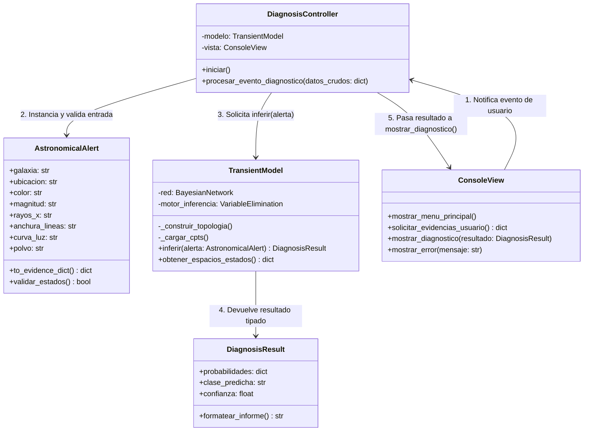
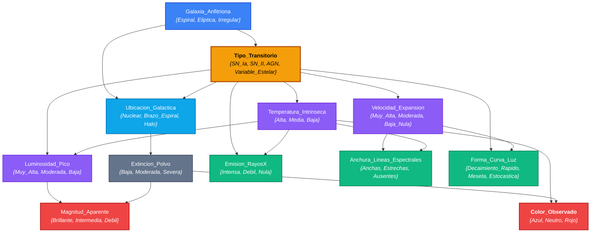

# Especificación Técnica: Arquitectura del Sistema y Diseño de la Red Bayesiana

**Materia:** Razonamiento con Incertidumbre (RAIN) - Grado en Inteligencia Artificial  
**Autores:** Anxo Grandal Lama y Hugo Martínez Estévez  
**Estado:** Documento formal de arquitectura y modelado causal (Hito Sesiones 5 a 7)

---

## 1. Arquitectura del Software: Patrón MVC

Para cumplir con la separación de responsabilidades y permitir la ejecución local desacoplada, la aplicación se estructura bajo el patrón **Modelo-Vista-Controlador (MVC)** apoyado en objetos de transferencia de datos:

### 1.1. Responsabilidades y Flujo de Interacción
1. **Entrada de datos (`ConsoleView`):** La vista captura las observaciones del usuario (alertas telescópicas reales o simuladas) y las envía al controlador sin interactuar con la lógica bayesiana.
2. **Validación y mediación (`DiagnosisController` y `AstronomicalAlert`):** El controlador recibe los datos crudos, valida que los estados observados pertenezcan a los dominios físicos permitidos instanciando un objeto tipado `AstronomicalAlert`, y solicita el diagnóstico al modelo.
3. **Núcleo probabilístico (`TransientModel`):** Encapsula tanto la inicialización de la red bayesiana en `pgmpy` (`_construir_topologia()` y `_cargar_cpts()`) como el cálculo probabilístico exacto mediante `VariableElimination`, empaquetando la distribución posterior en un objeto `DiagnosisResult`.
4. **Presentación de resultados:** El controlador recibe `DiagnosisResult` y le ordena a la vista mostrar el informe ordenado de probabilidades.

---

## 2. Especificación Formal de Variables y Espacios de Estados

El dominio modela **12 variables discretas**, exhaustivas y mutuamente excluyentes, organizadas desde el contexto galáctico y las propiedades físicas latentes hasta las mediciones instrumentales del telescopio:

| Variable | Rol en la Red | Espacio de Estados Discretos | Justificación Física / Dominio Astrofísico |
| :--- | :--- | :--- | :--- |
| **`Galaxia_Anfitriona`** | Contexto Causal (Prior) | `{Espiral, Eliptica, Irregular}` | Entorno estelar previo; las galaxias elípticas carecen de gas frío para formar estrellas masivas (impidiendo SN II). |
| **`Tipo_Transitorio`** | **Diagnóstico (Objetivo)** | `{SN_Ia, SN_II, AGN, Variable_Estelar}` | Fenómeno astrofísico real subyacente que el sistema debe inferir. |
| **`Ubicacion_Galactica`** | Estado Espacial / Observable | `{Nuclear, Brazo_Espiral, Halo}` | Coordenada en la galaxia; los AGN residen en el núcleo y las SN II en brazos espirales ricos en formación estelar. |
| **`Extincion_Polvo`** | Medio Interestelar | `{Baja, Moderada, Severa}` | Densidad de polvo cósmico en la línea de visión condicionada por la zona galáctica atravesada. |
| **`Temperatura_Intrinseca`** | Física Térmica Latente | `{Alta, Media, Baja}` | Temperatura efectiva de emisión en el foco antes de sufrir dispersión en el medio interestelar. |
| **`Luminosidad_Pico`** | Física Energética Latente | `{Muy_Alta, Moderada, Baja}` | Potencia lumínica intrínseca emitida por el evento (las supernovas Ia y los AGN brillan órdenes de magnitud más que las variables). |
| **`Velocidad_Expansion`** | Dinámica Cinemática Latente | `{Muy_Alta, Moderada, Baja_Nula}` | Velocidad física real de las capas de gas expulsadas o del disco de acreción. |
| **`Color_Observado`** | Observable Fotométrico | `{Azul, Neutro, Rojo}` | Índice de color aparente; colisionador entre la temperatura intrínseca y el enrojecimiento por polvo. |
| **`Magnitud_Aparente`** | Observable Fotométrico | `{Brillante, Intermedia, Debil}` | Brillo captado por el sensor; colisionador entre la luminosidad intrínseca y la absorción por polvo. |
| **`Emision_RayosX`** | Observable Alta Energía | `{Intensa, Debil, Nula}` | Flujo de fotones energéticos originado por acreción relativista (AGN) o choques térmicos extremos. |
| **`Anchura_Lineas_Espectrales`** | Observable Espectroscópico | `{Anchas, Estrechas, Ausentes}` | Ensanchamiento Doppler medido en el espectro óptico producto de la velocidad de expansión y agitación térmica. |
| **`Forma_Curva_Luz`** | Observable Temporal | `{Decaimiento_Rapido, Meseta, Estocastica}` | Evolución del brillo en el tiempo regulada por el mecanismo del transitorio y la velocidad de vaciado de la envoltura. |

---

## 3. Topología Causal y Arquitectura de la Red Bayesiana (DAG)

El Grafo Acíclico Dirigido (DAG) modela el flujo causal completo en cuatro estratos de profundidad: (1) entorno galáctico, (2) evento transitorio subyacente, (3) propiedades físicas intrínsecas y del medio local, y (4) señales astronómicas observables en los instrumentos:

### 3.1. Justificación de las Cadenas Causales y Profundidad de la Red

1. **Rama Espacial y de Atenuación del Medio (`Galaxia` $\rightarrow$ `Ubicacion` $\rightarrow$ `Polvo`):**
   * La morfología de la `Galaxia_Anfitriona` y la naturaleza del `Tipo_Transitorio` determinan la `Ubicacion_Galactica` donde se produce el fenómeno.
   * Esta coordenada espacial condiciona directamente la `Extincion_Polvo`: los eventos situados en el núcleo galáctico o inmersos en los brazos espirales atraviesan nubes densas de polvo interestelar, mientras que los eventos en el halo periférico presentan una línea de visión limpia.
2. **Rama Fotométrica y Doble Estructura Colisionadora (`Color_Observado` y `Magnitud_Aparente`):**
   * El polvo interestelar actúa sobre dos observables fotométricos simultáneos generando dos estructuras en V (*colliders*):
     * **Enrojecimiento (`Temperatura_Intrinseca` $\rightarrow$ `Color_Observado` $\leftarrow$ `Extincion_Polvo`):** Un objeto intrínsecamente azul (alta temperatura) será observado como rojo si existe extinción severa.
     * **Atenuación de Brillo (`Luminosidad_Pico` $\rightarrow$ `Magnitud_Aparente` $\leftarrow$ `Extincion_Polvo`):** Un evento de altísima energía (`Luminosidad_Pico = Muy_Alta`, determinado por el tipo de explosión y su temperatura) puede registrarse con una `Magnitud_Aparente = Debil` si la columna de polvo bloquea los fotones en ruta.
3. **Rama de Alta Energía (`Tipo_Transitorio` y `Temperatura` $\rightarrow$ `Emision_RayosX`):**
   * La detección de rayos X requiere o bien mecanismos no térmicos relativistas propios de la corona de un `AGN`, o bien ondas de choque con temperaturas extremas (`Temperatura_Intrinseca = Alta`).
4. **Rama Espectroscópica y Temporal (`Velocidad_Expansion` $\rightarrow$ `Anchura_Lineas` y `Curva_Luz`):**
   * La `Velocidad_Expansion` no es leída directamente por el telescopio, sino que se infiere a través de su efecto físico sobre el espectro: provoca el ensanchamiento por efecto Doppler en la `Anchura_Lineas_Espectrales` (junto con el ensanchamiento térmico de la temperatura) y regula el tiempo de difusión de los fotones que da forma a la `Forma_Curva_Luz`.

---

## 4. Factorización de la Distribución Conjunta

Aplicando la propiedad de Markov local sobre los 12 nodos del DAG, la distribución de probabilidad conjunta global se factoriza como:

$$P(G, T, U, E, \theta, L_p, V, M, C, X, A, F) = P(G) \cdot P(T \mid G) \cdot P(U \mid G, T) \cdot P(E \mid U) \cdot P(\theta \mid T) \cdot P(L_p \mid T, \theta) \cdot P(V \mid T) \cdot P(M \mid L_p, E) \cdot P(C \mid \theta, E) \cdot P(X \mid T, \theta) \cdot P(A \mid V, \theta) \cdot P(F \mid T, V)$$

Donde la notación corresponde a:
* $G$: `Galaxia_Anfitriona`
* $T$: `Tipo_Transitorio` (nodo diagnóstico)
* $U$: `Ubicacion_Galactica`
* $E$: `Extincion_Polvo`
* $\theta$: `Temperatura_Intrinseca`
* $L_p$: `Luminosidad_Pico`
* $V$: `Velocidad_Expansion`
* $M$: `Magnitud_Aparente`
* $C$: `Color_Observado`
* $X$: `Emision_RayosX`
* $A$: `Anchura_Lineas_Espectrales`
* $F$: `Forma_Curva_Luz`